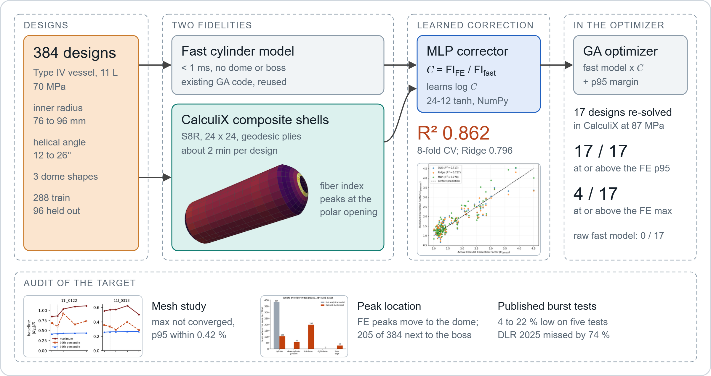

# Type IV dome correction: multi-fidelity sizing of hydrogen vessels, and an audit of the target

[Preprint (PDF)](paper/main.pdf) · [Details](docs/details.md) · [Validation](docs/VALIDATION.md) · [Data](data/) · [Cite](CITATION.cff)



An MLP trained on 384 CalculiX composite-shell simulations corrects the fiber failure index of a fast, cylinder-only sizing model for 11 L Type IV vessels (cross-validated R² 0.862 on log C, Ridge 0.796). A mesh and modelling audit then shows that the peak it learns sits at the polar opening and is not mesh-converged, so the correction is usable as a conservative margin, not as evidence of a physical dome effect.

## Method

The fast thick-cylinder model runs in under a millisecond but has no dome, boss or winding-angle change. A CalculiX model of the whole vessel (S8R composite shells, 24 x 24 elements, geodesic winding, one boss fixed and one sliding) gives the dome-resolved fiber index FI = max |σ11| / X over elements and plies. For each of 384 designs (inner radius 76 to 96 mm, helical angle 12 to 26°, three dome shapes, 70 MPa) the target is log C with C = FI(CalculiX) / FI(fast). OLS, Ridge and a NumPy MLP (24-12 tanh) are fit on 288 designs and tested on 96 held out; the optimizer then uses the fast model times the predicted C plus a p95 residual margin. Full formulation: [docs/details.md](docs/details.md).

All the work here is mine (Arts et Métiers, May to June 2026; audit in October 2026): the CalculiX model generator, the DOE, the dataset, the correctors, the GA coupling layer ([`ga_correction.py`](code/optimization/ga_correction.py)), the audit and the preprint. The GA optimizer and its fast model are a pre-existing 2025 codebase that I did not write and that is not included here.

## Results

| Quantity | Value | Source |
|---|---|---|
| R² on log C, repeated 8-fold CV (288 designs) | MLP 0.862 ± 0.029, Ridge 0.796 ± 0.046, OLS 0.791 ± 0.047 | `data/extended_statistical_metrics.json` |
| R² on log C, 96 held-out designs | MLP 0.778, Ridge 0.727 | same file |
| R² at untrained pressures (24 designs) | OLS 0.726, MLP 0.714 | same file |
| Correction factor C over the DOE | 1.00 to 4.51, median 1.42 | `data/fiber_proxy_dataset.csv` |
| GA check, 17 designs re-solved at 87 MPa | corrected index ≥ CalculiX p95 for 17/17, ≥ CalculiX max for 4/17 (raw: 0/17) | `data/ga_statistical_validation.csv` |
| Mesh study, 4 designs, 16 to 64 elements | max of design 0122 goes 0.85 → 1.11; p95 moves at most 0.42 % from 48 to 64 | `data/paper_mesh_study.csv` |

`python scripts/readme_numbers.py` recomputes these numbers from `data/`. The full audit (peak location, DOE consistency, end-cap force, published burst tests) is in [docs/details.md](docs/details.md#verification-and-audit) and section 6 of the preprint.


*Left: fiber index |σ11|/X, worst ply per element, design `11l_0122` at 70 MPa. Right: critical zone over the 384 designs.*

## Install and quick start

Tested on Windows 10, Python 3.11.9, NumPy 2.2.6, pandas 2.3.0.

```bash
pip install -r requirements.txt
python code/calibration/extended_statistical_validation.py   # correctors and CV, ~4.5 min
python scripts/readme_numbers.py                             # README numbers, ~15 s
bash paper/build_paper.sh                                    # paper figures, numbers and PDF
```

CalculiX 2.23 campaign commands: [docs/details.md](docs/details.md#all-run-commands). Raw `.frd` files (about 20 MB per design) are not versioned.

## Code structure

| Path | Content |
|---|---|
| `code/config/` | DOE generator, material database |
| `code/high_fidelity/` | CalculiX input generator, runner, post-processing |
| `code/calibration/` | dataset build, correctors and validation (NumPy MLP) |
| `code/optimization/ga_correction.py` | correction layer called by the external GA |
| `code/paper/` | audit campaigns and paper figures |
| `data/` | DOE cases, datasets, metrics, GA check, audit results |
| `paper/` | preprint source, generated numbers, PDF |

## Limitations

- Linear elastic shells, with no liner, progressive damage or liner/boss contact; one vessel family (11 L, single boss, geodesic winding).
- The learned maximum is not mesh-converged and depends on the coverage floor and on the missing end-cap force; only the p95 is converged.
- No physical test of my own. Published burst tests are matched to 4 to 22 % on five tests, and the DLR 2025 test is missed by 74 %; those benchmark runs are not versioned.
- The GA is not public, so the 17-design check cannot be re-run from this repo.

## Citation and license

Cite with [`CITATION.cff`](CITATION.cff) or the preprint. MIT license, see [LICENSE](LICENSE). Built on [CalculiX](http://www.calculix.de/) 2.23 and ParaView; published tests and methods are cited in [`paper/references.bib`](paper/references.bib).

Clément Dumeril · [clement.dumeril.net](https://clement.dumeril.net)
