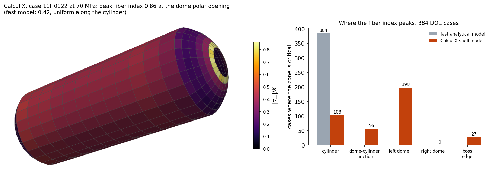
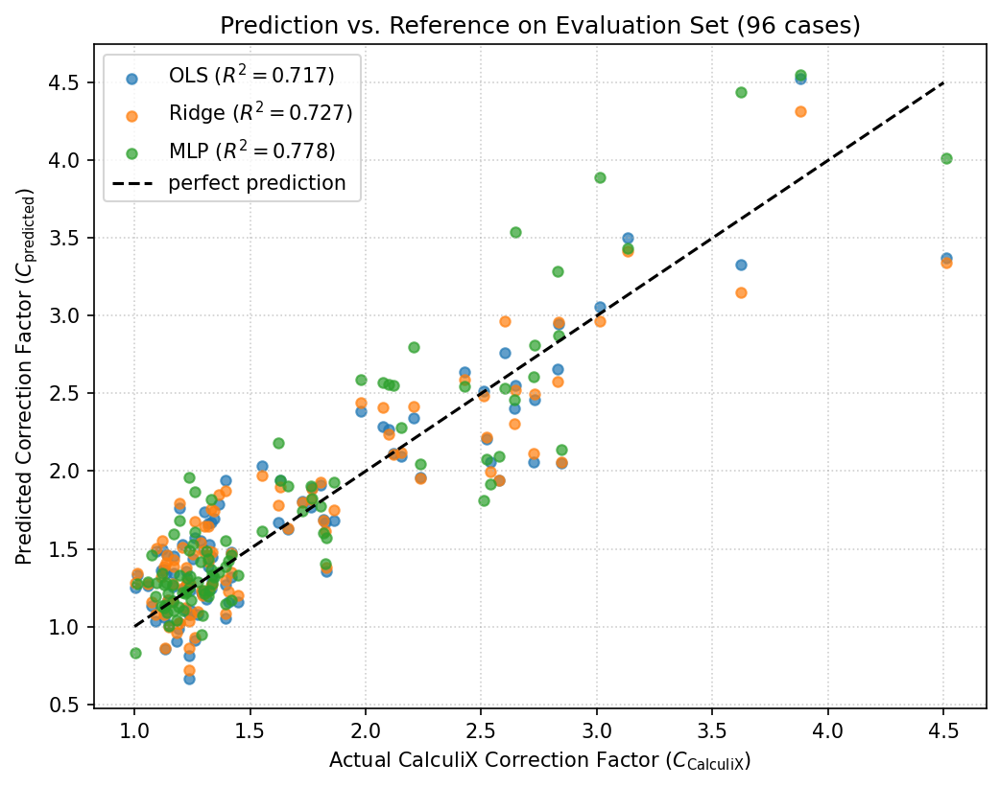
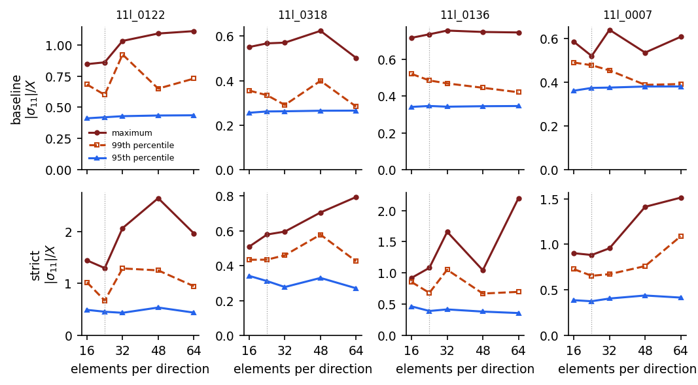

# A learned dome correction for Type IV vessel sizing, and an audit of its high-fidelity target

The Type IV hydrogen tank optimizer I started from uses a fast analytical model that only sees the cylinder. I built a CalculiX composite-shell model of the whole vessel, ran it on 384 designs, and trained a small MLP that corrects the fast model's fiber failure index. The MLP fits that target well (cross-validated R² 0.862 on log C, against 0.796 for Ridge), but my audit showed that what it learns is mostly a mesh-dependent peak at the polar opening, not a physical dome effect.


*Left: fiber index |σ11|/X, worst ply per element, design `11l_0122` at 70 MPa. Right: critical zone over the 384 designs.*

I did this at Arts et Métiers, May to June 2026, and ran the audit in October 2026. I did all of the modeling, code and analysis myself. The optimizer and its fast model come from an existing 2025 codebase that I did not write. Details are in the preprint: [`paper/main.pdf`](paper/main.pdf).

## Results

The MLP predicts C = FI(CalculiX) / FI(fast model) from the design inputs.

| R² on log C | Ridge | MLP |
|---|---:|---:|
| Repeated 8-fold CV, 288 training designs | 0.796 | 0.862 |
| 96 held-out designs | 0.727 | 0.778 |



I then ran the optimizer with the corrected model (10 seeds, 17 designs) and re-solved each design in CalculiX at 87 MPa (the optimizer's design burst pressure; not stored in `data/ga_statistical_validation.csv`). The corrected index is above the CalculiX 95th percentile for all 17, but above the CalculiX maximum for only 4.

## Audit

The target is the maximum of the shell-model fiber index, and in 205 of the 384 designs that maximum sits within 1.25 boss radii of the polar opening (190 of them on the axially fixed left boss). It is not mesh-converged: for design 0122 it goes from 0.85 at 16×16 to 1.11 at 64×64, while the 95th percentile changes by about 0.4 % between 48 and 64. The peak also depends on a coverage convention near the pole and on a missing end-cap load. See section 6 of the paper.



## Running it

```bash
pip install -r requirements.txt                              # Python >= 3.10
python code/calibration/extended_statistical_validation.py   # about 3 min
bash paper/build_paper.sh                                    # paper figures and PDF (needs latexmk)
```

The CalculiX runs use [`code/paper/run_campaign.py`](code/paper/run_campaign.py) with CalculiX 2.23 (set `CCX`). Raw `.frd` files are not versioned. These scripts overwrite the committed files in `figures/`, `data/` and `paper/`.

## Limitations

The shells are linear elastic, with no liner, damage or contact, and all designs belong to one vessel family. Against published burst tests the model is 4 to 22 % low on five and misses the DLR 2025 test ([docs/VALIDATION.md](docs/VALIDATION.md)). The optimizer is not public, so the GA check cannot be re-run from this repo.

## Corrections

October 2026: the metrics are unchanged, but section 6 of the paper replaces my earlier reading of the dome peak as a physical, hoop-driven effect.

## Credits

- Genetic-algorithm optimizer and fast analytical model: an existing 2025 codebase, not written by me and not included here.
- [CalculiX](http://www.calculix.de/) 2.23 and ParaView. Published tests are cited in [`paper/references.bib`](paper/references.bib).

Clément Dumeril · [clement.dumeril.net](https://clement.dumeril.net) · [github.com/clementdumeril](https://github.com/clementdumeril)
