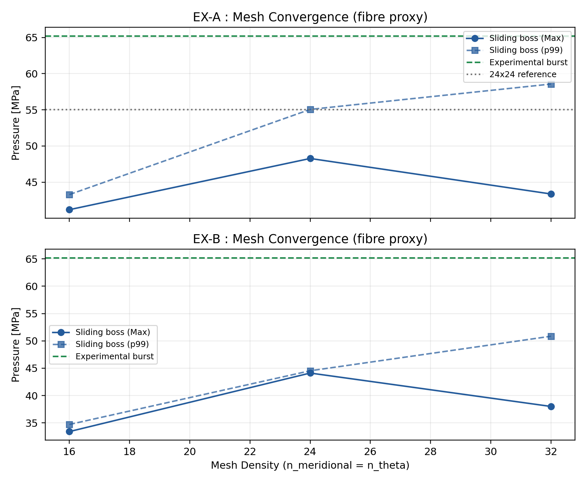

# Validation details

Details behind the main [README](../README.md). The numbers come from files in [`data/`](../data), and the audit is in section 6 of [`paper/main.pdf`](../paper/main.pdf).

## Design of experiments

All 384 cases are at a fixed 11 L internal volume ([`code/config/generate_doe_11l.py`](../code/config/generate_doe_11l.py)) and were solved in CalculiX.

| Parameter | Range in the 384-case DOE |
|---|---|
| Inner radius | 76 to 96 mm (cylinder length 257 to 550 mm) |
| Boss radius | 21.5 to 34.1 mm |
| Dome shape | hemispherical, isotensoid-like, variable contour (128 each) |
| Helical angle | 12 to 26° |
| Helical / transition / hoop pairs | 4–5 / 1–2 / 2–3 |
| Total thickness | 10.5 to 26.1 mm |
| Pressure | 70 MPa (360 cases); 52.5 and 87.5 MPa (12 each) |
| Hoop thickness kept in the dome (`coverage_epsilon`) | 0.20 to 0.35 |

Below its turnaround radius, every ply keeps `coverage_epsilon` of its thickness at an angle near 87°, a numerical convention. The DOE also applies no end-cap force to the polar edges ([`data/paper_endcap.csv`](../data/paper_endcap.csv) tests adding it).

Case roles are fixed in [`data/doe_11l_single_boss_cases.json`](../data/doe_11l_single_boss_cases.json): 288 train, 48 in-distribution holdout, 24 geometric boundary, 24 pressure scale.

## Correctors

All models are in [`code/calibration/extended_statistical_validation.py`](../code/calibration/extended_statistical_validation.py), in NumPy.

- Target: log C, with C = FI(CalculiX) / FI(fast model), the fiber index |σ11|/X of the worst ply.
- Models: constant, OLS, Ridge (α = 10), MLP 24×12 with tanh, trained with Adam, backpropagation written by hand.
- Cross-validation: 8 folds, repeated 4 times, on the 288 training cases only.

| R² on log C | Constant | OLS | Ridge | MLP |
|---|---:|---:|---:|---:|
| Repeated 8-fold CV (288) | −3.91 | 0.791 | 0.796 | 0.862 |
| Held-out, all (96) | −4.01 | 0.717 | 0.727 | 0.778 |
| In-distribution holdout (48) | −5.90 | 0.770 | 0.787 | 0.789 |
| Geometric boundary (24) | −2.27 | 0.647 | 0.672 | 0.800 |
| Pressure extrapolation (24) | −4.02 | 0.726 | 0.703 | 0.714 |

Full metrics: [`data/extended_statistical_metrics.json`](../data/extended_statistical_metrics.json).

## GA check

10 seeds gave 17 distinct designs, each re-solved in CalculiX at 87 MPa ([`data/ga_statistical_validation.csv`](../data/ga_statistical_validation.csv)).

| Prediction is at or above CalculiX… | p95 of the fiber index | pointwise maximum |
|---|---:|---:|
| fast model, raw | 0 / 17 | 0 / 17 |
| fast model × MLP correction (p95 margin) | 17 / 17 | 4 / 17 |

In 5 of the 17 designs, the CalculiX maximum exceeds 1.

## Published burst tests

Same shell model as the DOE, with geometry and layups rebuilt from each paper.

| Source | Vessel | Measured | Model | Gap |
|---|---|---:|---:|---:|
| Hu, Chen & Pan 2021 | 70 MPa H₂ vessel, no dome reinforcement | 161 MPa (first fiber damage) | 148.7 MPa | −7.6 % |
| Agne et al. 2025 | GFRP | 29.39 MPa | 25.4 to 27.7 MPa | −6 to −14 % |
| Agne et al. 2025 | CFRP | 27.04 MPa | 25.7 to 25.9 MPa | −4 to −5 % |
| Jin et al. 2024 | EX-A, 32×32 mesh, p99 | 65.2 MPa | 58.6 MPa | −10 % |
| Jin et al. 2024 | EX-B, 32×32 mesh, p99 | 65.17 MPa | 50.8 MPa | −22 % |
| Lueders et al. 2025 (DLR) | SN03, simplified layup | 25.37 MPa | 11.8 MPa | −53 % |
| Lueders et al. 2025 (DLR) | SN03, published layup book | 25.37 MPa | 6.5 MPa | −74 % |

For Hu, the model fails a hoop ply in the cylinder while the paper reports the dome. The DLR test is not reproduced; likely causes are the spherical-cap dome contour, the coverage law near the turnaround, and no progressive damage.

## Mesh study

Vessels EX-A and EX-B of Jin et al. 2024, at 16, 24 and 32 elements per direction ([`data/jin2022_mesh_convergence.csv`](../data/jin2022_mesh_convergence.csv)).

| Predicted burst (MPa) | 16 | 24 | 32 |
|---|---:|---:|---:|
| EX-A, maximum | 41.2 | 48.3 | 43.4 |
| EX-A, p99 | 43.3 | 55.1 | 58.6 |
| EX-B, maximum | 33.4 | 44.1 | 38.0 |
| EX-B, p99 | 34.7 | 44.5 | 50.8 |

The maximum does not converge. The p99 still moves by 6 % (EX-A) and 14 % (EX-B) between the last two meshes.

## Liner / boss contact

Tested on two cases of my earlier 128-case DOE, never included in the 384-case DOE. Tied vs penalty contact moved the stresses by 7.5 to 8 %. Frictional contact never ran reliably.
