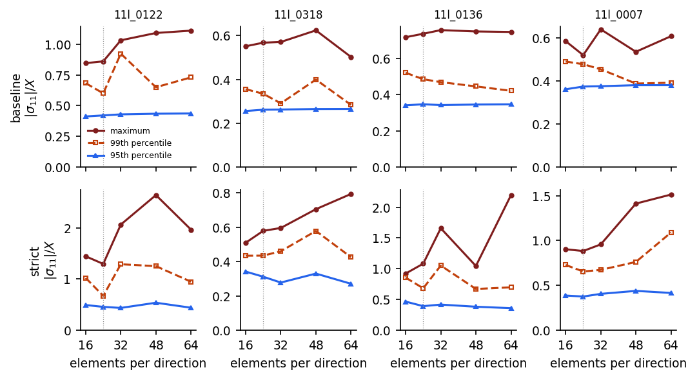

# Details

Supporting material for the [README](../README.md). The full report is [`paper/main.pdf`](../paper/main.pdf); burst-test comparison, parameter table and GA check are in [VALIDATION.md](VALIDATION.md).

## Formulation

**Shell model.** Eight-node reduced-integration shells (S8R) in CalculiX 2.23 cover the cylinder, both domes and the polar openings, 24 x 24 elements (meridional x circumferential, six along each dome meridian). Each element has its own composite section. Helical and transition plies follow the geodesic law sin α(r) = r_t / r with r_t = R sin α0; hoop plies keep 86.5 to 89.5°. Below its turnaround radius a ply keeps a thickness floor ε (0.20 to 0.35) at about 87°, a numerical convention rather than a winding law.

**Loads and boundary conditions.** Uniform internal pressure (`*DLOAD`), linear static. One boss is fixed axially and the other slides, so the vessel can elongate. No liner, no damage, no contact. The end-cap force p π r_boss² is off in every DOE design; its effect is measured in the audit.

**Material.** Carbon/epoxy lamina, E1 = 151 GPa, E2 = E3 = 9 GPa, G12 = 5 GPa, ν12 = 0.30, ν23 = 0.42, X_T = 2000 MPa, X_C = 1500 MPa ([`code/config/material_database.json`](../code/config/material_database.json)).

**Target.** FI = max over (element, ply) of |σ11| / X_T in tension or |σ11| / X_C in compression; the 95th and 99th percentiles are also stored. The regression target is log C, with C = FI(CalculiX) / FI(fast model).

**DOE and correctors.** 384 designs at 11 L internal volume: inner radius 76 to 96 mm, three dome shapes, helical angle 12 to 26°, thickness 10.5 to 26.1 mm, 70 MPa (52.5 and 87.5 MPa for the pressure split). Roles are fixed before training: 288 train, 48 in-distribution holdout, 24 geometric boundary, 24 untrained pressure. Models: constant, OLS, Ridge (α = 10), and an MLP with 24 and 12 tanh units, written in NumPy with hand-coded backpropagation and Adam. Cross-validation uses 8 folds repeated 4 times on the training designs. The full parameter table is in [`docs/VALIDATION.md`](VALIDATION.md).

## Verification and audit

| Check | Finding | Source |
|---|---|---|
| Mesh study, 4 designs, 16 to 64 elements per direction | max index of design 0122 goes 0.85 → 1.11; the p95 moves at most 0.42 % between 48 and 64 | `data/paper_mesh_study.csv` |
| Peak location | 205 of 384 maxima at a radius below 1.25 boss radii, 190 of them on the axially fixed boss | `data/baseline_fiber_peak_location.csv` |
| Geometric consistency of the DOE | in 202 of 384 designs no helical ply can reach the polar opening (R sin α > r_boss) | `data/doe_11l_single_boss_cases.json` |
| End-cap force added, 4 designs, 64 x 64 | max index +27 to +54 %, p95 within 0.8 % | `data/paper_endcap.csv` |
| Published burst tests | 4 to 22 % low on five tests; the DLR 2025 test is missed by 74 % | [`docs/VALIDATION.md`](VALIDATION.md); benchmark runs not versioned |


*Maximum, 99th and 95th percentiles of the fiber index against mesh density. Top: the DOE model, where only the 95th percentile settles. Bottom: plies stopped at their turnaround radius (preprint, section 6).*

The MLP fits its target well, but that target is mostly a numerical peak at the pole. The correction is usable as a conservative margin against the converged p95, not as evidence of a physical dome effect. Section 6 of the preprint has the full audit, including the coverage-floor ablation and the strict-turnaround re-analysis.

`python scripts/readme_numbers.py` recomputes every number in the two tables above from `data/` (except the burst-test row).

## Corrections

October 2026: the metrics are unchanged, but section 6 of the preprint replaces my earlier reading of the dome peak as a physical, hoop-driven effect.

## All run commands

Tested on Windows 10 with Python 3.11.9, NumPy 2.2.6, pandas 2.3.0 and Matplotlib 3.10.6 (November 2026: the validation script reproduced the committed metrics JSON exactly in 4.5 min).

```bash
pip install -r requirements.txt
python code/calibration/extended_statistical_validation.py   # correctors and CV, ~4.5 min
python scripts/readme_numbers.py                             # README numbers, ~15 s
bash paper/build_paper.sh                                    # paper figures, numbers.tex and PDF (needs latexmk)
```

These scripts overwrite the committed files in `figures/`, `data/` and `paper/`. To write the metrics elsewhere, set `TYPE4_METRICS_OUT=<path>` and `TYPE4_NO_FIGURES=1`. The CalculiX runs use [`code/paper/run_campaign.py`](../code/paper/run_campaign.py) and [`code/high_fidelity/run_calculix_doe.py`](../code/high_fidelity/run_calculix_doe.py) with CalculiX 2.23 (Windows build of 15 November 2025, 2 solver threads, set `CCX`); a 24 x 24 design takes about 2 minutes. Raw `.frd` files (about 20 MB per design) are not versioned.

## Reproducing figures

| Figure | Script |
|---|---|
| `figures/readme_hero.png`, `figures/readme_ga_check.png` | `code/plotting/make_readme_figures.py` |
| `figures/fiber_index_field_11l_0122.png` | `code/plotting/render_fiber_field.py` (ParaView pvpython) |
| `figures/extended_benchmark_nuage_en.png`, `figures/extended_benchmark_residus_en.png` | `code/calibration/extended_statistical_validation.py` |
| `figures/jin2022_mesh_convergence.png` | `code/plotting/plot_mesh_convergence_en.py` |
| `paper/figures/*.pdf`, `paper/generated/numbers.tex` | `code/paper/make_paper_figures.py` (called by `paper/build_paper.sh`) |
